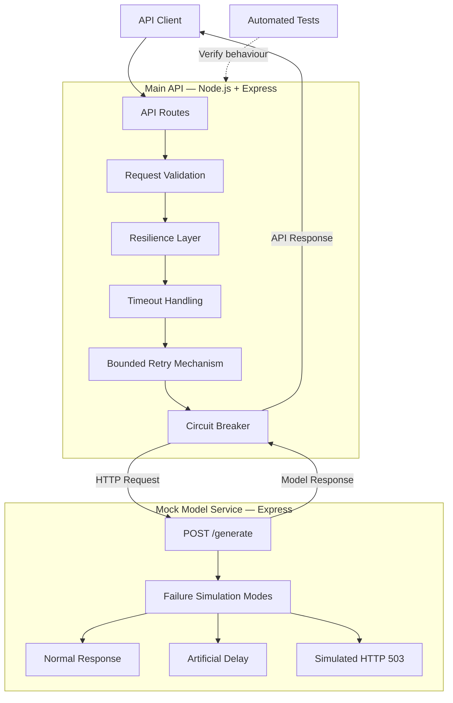

# System Architecture

## 1. Overview

AI API Resilience Evaluation is an experimental system designed to investigate how lightweight resilience strategies improve the reliability of AI-powered web APIs when their dependent model service experiences failures.

The system consists of two main applications:

- **Main API:** A Node.js and Express application that exposes the API endpoints and implements resilience mechanisms.
- **Mock Model Service:** A separate Express application that simulates an external AI model service under different operating conditions.

The separation of these applications allows controlled experiments to be performed without depending on an external AI provider.

## 2. High-Level Architecture

## 3. Main API

The Main API is responsible for receiving client requests, communicating with the mock model service, applying resilience strategies, and returning appropriate responses.

**Technology:** Node.js and Express

**Current endpoints:**

| Endpoint | Method | Purpose |
|---|---|---|
| `/` | GET | Returns basic API information |
| `/health` | GET | Checks API health |
| `/api/generate` | POST | Processes a generation request |
| `/api/circuit-breaker` | GET | Returns circuit breaker status |

### Request Processing

When a client sends a generation request:

1. The API validates the incoming request.
2. The circuit breaker determines whether an upstream request can be attempted.
3. The API communicates with the mock model service.
4. Timeout handling limits how long the API waits for the upstream response.
5. Bounded retries handle selected transient upstream failures.
6. The circuit breaker records the outcome and updates its state.
7. The API returns the resulting response to the client.

## 4. Mock Model Service

The mock model service represents an external AI model dependency.

It allows different operating conditions to be simulated in a controlled and repeatable manner.

**Technology:** Node.js and Express

**Port:** `4001`

**Endpoints:**

| Endpoint | Method | Purpose |
|---|---|---|
| `/health` | GET | Checks mock service health |
| `/generate` | POST | Simulates model generation |

### Failure Simulation Modes

The service currently supports the following modes:

| Mode | Behaviour |
|---|---|
| `normal` | Returns a successful simulated model response |
| `delay` | Delays the response by a configurable duration |
| `error` | Returns a simulated HTTP 503 response |

Complete service unavailability can also be simulated by stopping the mock model service.

These modes provide controlled conditions for evaluating how the main API responds to different failure scenarios.

## 5. Resilience Mechanisms

The main API currently implements three resilience mechanisms.

### 5.1 Timeout Handling

Timeout handling limits the amount of time the main API waits for the model service.

If the upstream service does not respond within the configured timeout period, the request is aborted and the API returns an appropriate error response.

### 5.2 Bounded Retries

The retry mechanism allows the API to make a limited number of additional attempts when selected transient upstream failures occur.

The current configuration permits:

- One initial request.
- Up to two additional retry attempts.
- A configurable delay between retry attempts.

This prevents unlimited retry behaviour.

### 5.3 Circuit Breaker

The circuit breaker monitors consecutive upstream failures and temporarily prevents further requests when the configured failure threshold is reached.

It operates using three states:

| State | Description |
|---|---|
| `CLOSED` | Requests are permitted normally |
| `OPEN` | Requests are temporarily rejected without contacting the model service |
| `HALF_OPEN` | A controlled recovery probe is permitted after the reset timeout |

If the recovery probe succeeds, the circuit returns to `CLOSED`. If it fails, the circuit returns to `OPEN`.

## 6. Testing Architecture

Automated tests are implemented using:

- Node.js built-in test runner (`node:test`).
- Node.js assertion module (`node:assert/strict`).
- Supertest for HTTP endpoint testing.
- Mocked upstream responses for controlled test scenarios.

The tests verify important behaviours, including circuit breaker transitions and recovery behaviour.

The project also uses manual API requests to validate failure scenarios against the running applications.

## 7. Experimental Architecture

The architecture supports controlled experiments by allowing the model service to operate under different conditions while the main API applies its resilience mechanisms.

The intended evaluation will compare API behaviour under different configurations, including a baseline without resilience mechanisms and configurations using individual or combined resilience strategies.

Potential evaluation measurements include:

- Request success and failure rates.
- Response latency.
- Number of upstream attempts.
- Circuit breaker state transitions.
- Recovery behaviour after service failures.

The experimental procedure and evaluation results will be documented separately as the project progresses.

## 8. Architecture Scope

The current implementation uses a simulated model service to provide reproducible failure conditions.

The mock service is an experimental dependency rather than a real AI model. This allows the research to focus on API reliability and resilience without requiring computationally expensive model training.

The architecture may be extended as the research and evaluation requirements develop.