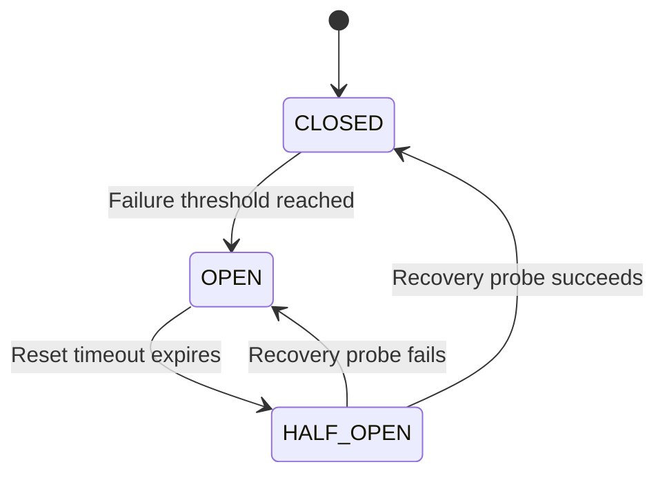

# Resilience Strategies

## 1. Introduction

AI-powered web applications often depend on external model services. These dependencies can introduce reliability challenges, including response delays, temporary service unavailability, and unexpected server errors.

This project investigates three lightweight resilience strategies designed to improve the reliability of an AI-powered web API under controlled model-service failures:

1. Timeout handling
2. Bounded retries
3. Circuit breaker

Each strategy addresses a different aspect of failure handling. Their individual and combined effectiveness will be evaluated through controlled experiments.

## 2. Timeout Handling

### 2.1 Purpose

A model service may take longer than expected to respond. Without a timeout, the main API may continue waiting for an upstream response, consuming resources and increasing client response times.

Timeout handling establishes a maximum waiting period for an upstream request.

### 2.2 Implementation

The main API uses `AbortController` to limit the duration of requests to the mock model service.

Current default configuration:

| Parameter | Value |
|---|---:|
| Model service timeout | 2,000 ms |

If the model service does not respond within the configured period, the request is aborted.

The main API handles the timeout and returns an appropriate gateway timeout response.

### 2.3 Expected Behaviour

- Requests completed within the timeout period can continue normally.
- Requests exceeding the timeout are aborted.
- The API returns a timeout error rather than waiting indefinitely.

### 2.4 Research Relevance

The experiments will investigate how timeout handling affects response latency and failure behaviour when the model service experiences artificial delays.

## 3. Bounded Retries

### 3.1 Purpose

Temporary upstream failures may occur even when a service is generally available. A retry mechanism allows the API to attempt another request instead of immediately returning an error.

However, unlimited retries can increase system load and make an existing failure worse.

Bounded retries restrict the number of additional attempts.

### 3.2 Implementation

The current implementation permits one initial request and up to two additional retry attempts.

| Parameter | Current value |
|---|---:|
| Maximum additional retries | 2 |
| Maximum total attempts | 3 |
| Delay between retries | 250 ms |
| Retryable upstream statuses | 502, 503, 504 |

The implementation does not retry requests that exceed the configured timeout. This avoids repeatedly waiting for a service that is already responding too slowly.

### 3.3 Expected Behaviour

1. The API sends the initial request.
2. If a selected retryable upstream failure occurs, the API waits for the configured retry delay.
3. The API attempts another request.
4. This process continues until a successful response is received or the retry limit is reached.
5. If all permitted attempts fail, the API returns an appropriate error response.

### 3.4 Research Relevance

The experiments will investigate whether bounded retries improve request success rates during temporary upstream failures and how they affect overall response latency and request volume.

## 4. Circuit Breaker

### 4.1 Purpose

Repeated requests to an unavailable model service can waste resources and increase unnecessary network traffic.

A circuit breaker helps prevent repeated requests to a dependency that is experiencing persistent failures.

It temporarily blocks requests after a configured failure threshold is reached and later permits a controlled recovery attempt.

### 4.2 Implementation

The current implementation uses three states:

| State | Description |
|---|---|
| `CLOSED` | Requests are permitted normally |
| `OPEN` | Requests are rejected without contacting the model service |
| `HALF_OPEN` | A controlled recovery probe is permitted |

Current default configuration:

| Parameter | Value |
|---|---:|
| Failure threshold | 3 failures |
| Reset timeout | 10,000 ms |

The circuit breaker tracks upstream request outcomes and updates its state accordingly.

### 4.3 State Transitions

**CLOSED**

The circuit allows requests to reach the model service. When the configured failure threshold is reached, it transitions to `OPEN`.

**OPEN**

The circuit temporarily prevents requests from reaching the model service. The API returns a service-unavailable response with recovery timing information.

After the reset timeout expires, the circuit transitions to `HALF_OPEN`.

**HALF_OPEN**

The circuit permits one recovery probe at a time.

- If the probe succeeds, the circuit transitions to `CLOSED`.
- If the probe fails, the circuit transitions back to `OPEN`.

### 4.4 State Transition Diagram

### 4.5 Research Relevance

The experiments will investigate how the circuit breaker affects unnecessary upstream requests, failure handling, and recovery behaviour when the model service becomes unavailable.

## 5. Combined Resilience Strategies

Although each mechanism addresses a different reliability concern, they can also operate together.

The combined approach uses:

- Timeout handling to limit upstream waiting time.
- Bounded retries to handle selected temporary failures.
- Circuit breaker protection to prevent repeated requests when failures persist.

The combined configuration will be evaluated against individual strategies and a baseline configuration.

The evaluation will help determine whether combining these mechanisms provides additional reliability benefits or introduces trade-offs such as increased latency.

## 6. Research Evaluation Criteria

The resilience strategies will be evaluated using measurable outcomes.

| Evaluation metric | Purpose |
|---|---|
| Success rate | Measures the proportion of successful requests |
| Failure rate | Measures the proportion of unsuccessful requests |
| Average latency | Measures average response time |
| Percentile latency | Examines response-time distribution |
| Upstream attempts | Measures the number of requests sent to the model service |
| Circuit state transitions | Measures circuit breaker behaviour |
| Recovery behaviour | Examines how the API responds when service availability returns |

The same controlled failure scenarios and experimental conditions should be used when comparing configurations.

## 7. Scope and Limitations

The current project uses a mock model service to simulate controlled upstream behaviour. It does not attempt to develop or train a new AI model.

The focus is on API-level resilience and empirical evaluation rather than model accuracy or model training performance.

The current timeout, retry, and circuit breaker values are implementation defaults. They may be adjusted in the experimental configuration when investigating different settings.

The effectiveness of the strategies will be established through experimental results rather than assumed in advance.